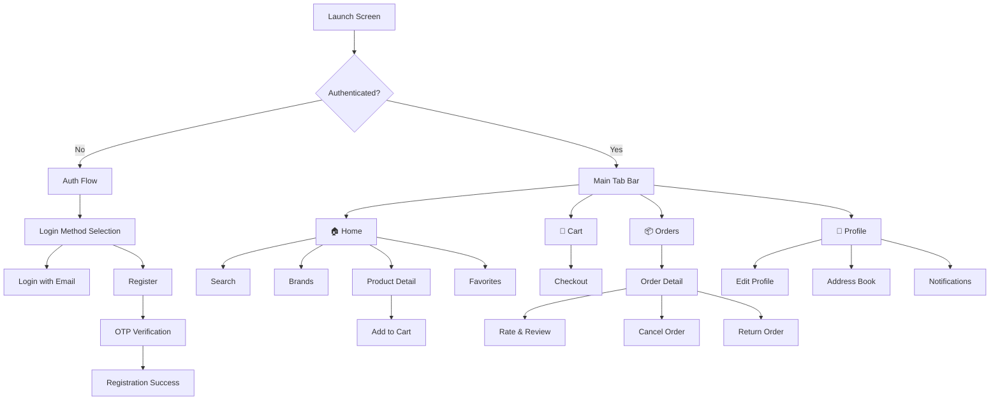

<div align="center">

# 👟 FSquare — Sneaker E-Commerce iOS App

**A native iOS e-commerce application for sneaker shopping, built with MVVM, Combine, and Coordinator pattern.**


-purple)


</div>

---

## 📖 Overview

**FSquare** is a native iOS e-commerce application designed for sneaker enthusiasts. The app provides a complete shopping experience — from browsing shoe brands and product catalogs to managing a shopping cart, placing orders, and tracking deliveries.

Built entirely in **Swift** with **UIKit**, the project follows a **layered MVVM architecture** with Coordinator-based navigation and reactive data binding via **Combine**. It communicates with a custom RESTful API backend for all data operations.

> **Note:** This is the **customer-facing (Buyer)** iOS client of the FSquare platform. The backend is a separate RESTful API service.

---

## ✨ Key Features

### 🔐 Authentication
- Email/password registration and login
- OTP verification flow
- JWT Bearer token authentication
- Session persistence via `UserDefaults`

### 🏠 Home & Product Discovery
- Featured and popular sneaker listings
- Brand-based filtering and browsing
- Full-text product search with search history
- Product detail view with classifications (color, size)
- Star rating and customer review display

### ❤️ Favorites
- Add/remove products from wishlist
- Real-time sync of favorite state across views using `Combine` + `SharedData` (ObservableObject)

### 🛒 Shopping Cart & Checkout
- Add-to-bag with size/color selection
- Cart item quantity management (stepper control)
- Shipping fee calculation via API
- Address selection during checkout
- Order placement with payment flow

### 📦 Order Management
- View order history with status filtering
- Order detail view
- Cancel order flow with confirmation popup
- Return/refund request flow
- Rate & review completed orders

### 👤 User Profile
- View and edit personal profile (name, avatar, phone)
- Avatar upload with image compression (multipart form-data)
- Address book (CRUD) with Vietnam province/district/ward API
- Notification center
- Contact & policy pages

---

## 🏗️ Architecture

The project follows a **layered MVVM architecture** with clear separation across three layers:

```
┌─────────────────────────────────────────────────┐
│                 Presentation                     │
│  ┌───────────┐  ┌────────────┐  ┌────────────┐ │
│  │   Views    │  │ ViewModels │  │Coordinators│ │
│  │(UIKit/XIB) │  │ (Combine)  │  │  (Nav)     │ │
│  └───────────┘  └────────────┘  └────────────┘ │
├─────────────────────────────────────────────────┤
│                   Domain                         │
│  ┌───────────┐  ┌────────────┐                  │
│  │  Entities  │  │  Use Cases │                  │
│  └───────────┘  └────────────┘                  │
├─────────────────────────────────────────────────┤
│                    Data                          │
│  ┌───────────┐  ┌────────────┐                  │
│  │Repositories│  │  Services  │                  │
│  │  (Impl)   │  │(API/Auth)  │                  │
│  └───────────┘  └────────────┘                  │
└─────────────────────────────────────────────────┘
```

### Design Patterns Used

| Pattern | Usage |
|---------|-------|
| **MVVM** | ViewControllers bind to ViewModels via `@Published` properties and Combine subscriptions for reactive UI updates |
| **Coordinator** | Navigation logic is decoupled from view controllers using 7 coordinators: `AppCoordinator`, `AuthCoordinator`, `TabBarCoordinator`, `HomeCoordinator`, `CartCoordinator`, `OrderCoordinator`, `ProfileCoordinator` |
| **Service Locator** | Centralized `DIContainer` (Singleton) resolves all dependencies — services, repositories, use cases, and view models |
| **Repository** | Data access is abstracted behind repository protocols, separating API communication from business logic |
| **Singleton** | `TokenManager`, `SharedData`, and `DIContainer` use singletons for shared state |
| **Observer** | `@Published` properties + Combine pipelines for reactive data flow between layers |

---

## 🛠️ Tech Stack

| Category | Technology |
|----------|------------|
| **Language** | Swift 5.0 |
| **UI Framework** | UIKit (XIB + Programmatic) |
| **Reactive Framework** | Combine |
| **Networking** | Alamofire (with `AuthInterceptor` for token attachment) |
| **Image Loading** | Kingfisher |
| **Keyboard Management** | IQKeyboardManagerSwift |
| **Loading States** | SkeletonView (shimmer placeholders) |
| **Progress Indicator** | ProgressHUD |
| **Backend** | Custom RESTful API (Node.js server) |
| **Dependency Management** | Swift Package Manager (SPM) |
| **Min Deployment Target** | iOS 17.2 |

---

## 📊 Project Scale

| Metric | Count |
|--------|-------|
| Swift source files | 208 |
| XIB layout files | 68 |
| Lines of Swift code | ~14,500 |
| API endpoints | 30+ |
| Coordinators | 7 |
| UIKit/Foundation extensions | 16 |
| SPM dependencies | 5 |

---

## 📁 Project Structure

```
FSquare/
├── Application/
│   ├── AppDelegate.swift              # App lifecycle & IQKeyboard setup
│   ├── SceneDelegate.swift            # Window scene configuration + AppCoordinator init
│   ├── DIContainer.swift              # Service Locator — resolves all dependencies
│   └── Coordinator/
│       └── AppCoordinator.swift       # Root navigation coordinator
│
├── Domain/
│   ├── Entities/
│   │   ├── Request/                   # Request DTOs (OrderRequest, etc.)
│   │   └── Response/                  # Response models (Shoes, Brand, Order, Profile, etc.)
│   └── UseCases/
│       ├── AuthUseCase/               # Login, Register, Verify OTP
│       ├── ShoesUseCases/             # Shoes listing, detail, classifications, sizes
│       ├── BrandUseCases/             # Brand catalog
│       ├── BagUseCase/                # Shopping bag add operation
│       ├── OrderUseCase/              # Order placement & tracking
│       ├── ProfileUseCase/            # Profile read & edit
│       ├── AddressUseCases/           # Address management
│       ├── FavoriteUseCase.swift      # Wishlist toggle
│       ├── NotificationUseCase.swift  # Notification fetching
│       └── GetProductsUseCase.swift   # Product listing
│
├── Data/
│   ├── Service/
│   │   ├── APIService.swift           # Generic API client (Alamofire + Combine)
│   │   └── AuthService.swift          # Auth-specific API client (no token required)
│   └── Repositories/
│       ├── ShoesRepository/           # Shoes + classification + size data access
│       ├── OrderRepository/           # Order data access
│       ├── BagReposotory/             # Cart/bag data access
│       ├── AuthRepository.swift       # Auth data access
│       ├── ProfileRepository.swift    # Profile data access
│       ├── AddressRepository.swift    # Address data access
│       ├── BrandRepository.swift      # Brand data access
│       ├── FavoriteRepository.swift   # Favorite data access
│       ├── NotificationRepository.swift
│       └── ProductRepository.swift    # Product data access
│
├── Presentation/
│   ├── AuthScene/                     # Login, Register, OTP Verification, Loading
│   │   └── Flow/AuthCoordinator.swift
│   ├── HomeScene/                     # Main feed, Search, Brands, Favorites, Product Detail, Add to Cart
│   │   └── Flow/HomeCoordinator.swift
│   ├── CartScene/                     # Shopping cart, Checkout, Payment
│   │   └── Flow/CartCoordinator.swift
│   ├── OrderScene/                    # My Orders, Order Detail, Rating, Cancel, Return
│   │   └── Flow/OrderCoordinator.swift
│   ├── ProfileScene/                  # Profile, Edit Profile, Address Book, Notifications, Contact, Policy
│   │   └── Flow/ProfileCoordinator.swift
│   ├── WalletScene/                   # E-Wallet screen (UI only)
│   ├── TabScene/                      # Tab bar controller & TabBarCoordinator
│   └── Launch/                        # LaunchScreen storyboard
│
├── Common/
│   ├── Constant/
│   │   └── AppApi.swift               # Centralized API endpoint definitions (30+ endpoints)
│   ├── Enums/                         # ButtonType, FontWeight, HTTPStatus, MenuOption, etc.
│   ├── Extensions/                    # 16 UIKit & Foundation extensions
│   └── Utilities/
│       ├── AuthInterceptor.swift      # Alamofire RequestInterceptor — attaches JWT token
│       ├── TokenManager.swift         # Token storage via UserDefaults
│       └── ViewCustom/               # Reusable UI components (Buttons, Labels, StarRating, Stepper, TextField)
│
├── SharedData.swift                   # ObservableObject for cross-view favorite state sync
│
└── Rescources/
    ├── Assets.xcassets                # Image and color assets
    ├── Font/                          # Custom Inter variable font
    └── Localizable.xcstrings          # Localization strings
```

---

## 🔌 API Integration

The app communicates with a custom RESTful API backend. Key API modules include:

- **Authentication** — Registration, email login, OTP verification
- **Products** — Shoes listing, popular shoes (statistics), search
- **Product Detail** — Detail info, classifications (colors), size options, reviews
- **Brands** — Brand catalog
- **Favorites** — Add/remove wishlist items
- **Cart (Bag)** — CRUD operations on cart items
- **Orders** — Create, view, cancel, return orders; shipping fee calculation
- **Profile** — View/edit profile, avatar upload (multipart form-data)
- **Address** — CRUD with Vietnam administrative divisions (Province → District → Ward)
- **Notifications** — Fetch notification list
- **Payments** — Payment processing
- **Search History** — Save/retrieve/delete search history

All authenticated requests use JWT Bearer tokens, attached automatically via a custom `AuthInterceptor` (Alamofire `RequestInterceptor`).

---

## 🚀 Getting Started

### Prerequisites

- **Xcode 15.0+**
- **iOS 17.2+** deployment target
- **Swift 5.0**
- Active internet connection (for API services)

### Installation

1. **Clone the repository**
   ```bash
   git clone https://github.com/your-username/FSquare-iOS.git
   cd FSquare-iOS
   ```

2. **Open in Xcode**
   ```bash
   open FSquare.xcodeproj
   ```

3. **Resolve Swift Packages**
   - Xcode will automatically fetch SPM dependencies (Alamofire, Kingfisher, IQKeyboardManager, ProgressHUD, SkeletonView).

4. **Build & Run**
   - Select a simulator or connected device with iOS 17.2+.
   - Press `Cmd + R` to build and run.

---

## 📸 App Flow



---

## 🧪 Technical Highlights

- **Reactive Data Binding**: All ViewModels expose `@Published` properties consumed by ViewControllers via Combine subscriptions (`sink`, `assign`), ensuring UI consistency without manual state management.
- **Generic Networking Layer**: A protocol-based `APIService` with generic request methods supporting both `[String: Any]` and `Encodable` parameter types, with centralized error handling and custom error response parsing.
- **Token Management**: `AuthInterceptor` (Alamofire `RequestInterceptor`) automatically attaches JWT Bearer tokens to authenticated requests via the `adapt` method.
- **Coordinator Navigation**: Full decoupling of navigation from view controllers — 7 coordinators manage all screen transitions, making the navigation graph easy to modify.
- **Service Locator Container**: All dependencies (services, repositories, use cases, view models) are constructed through a centralized `DIContainer`, enabling modular development.
- **16 UIKit/Foundation Extensions**: Rich set of extensions covering UIView animations, UILabel styling, UIImageView loading, UIColor hex conversion, Date formatting, NumberFormatter, URL handling, and more.
- **Custom Reusable Components**: Star rating view, stepper control, custom buttons/labels, padded labels, and text fields — all built as standalone reusable XIB-backed or programmatic components.
- **Versioned API Strategy**: Endpoints conditionally switch between v1 (authenticated) and v2 (public) API versions based on user authentication status.

---

## 👥 Team & Role

| Role | Responsibility |
|------|---------------|
| **iOS Developer** | Designed and implemented the iOS client application — architecture, UI (68 XIBs + programmatic), API integration, and state management |

---

## 📄 License

This project is for educational and portfolio purposes.

---

<div align="center">

**Built with ❤️ using Swift & UIKit**

</div>
